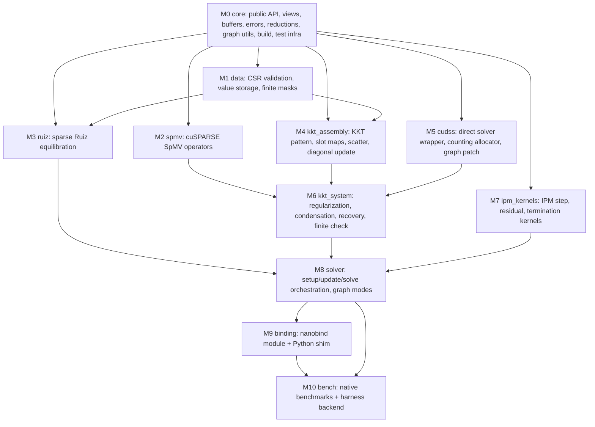

# Module dependency graph and work plan

Critical path: M0 -> M4 -> M6 -> M8 -> M9 -> M10. M5 runs alongside M4 (its
contract fixes the KKT buffer it consumes). M1, M2, M3, M5 and M7 can start as
soon as M0 is merged. M3 and M4 need only M1's `SparseData` header, which M0
defines, so they do not wait for M1's implementation.

## Waves

| Wave | Modules | Owner |
|---|---|---|
| 0 | M0 | integration owner (main session), branch `native-cuda-port` |
| 1 (parallel) | M1, M2, M3, M4, M5, M6, M7 (against the M0 interface headers) | one agent each, branch `task/<module>`, worktree `~/Projects/cupiqp-native-wt/<module>` |
| 2 | M6 end-to-end KKT tests after M2, M4, M5 merge | M6 agent (continued) |
| 3 | M8, M9 | integration owner |
| 4 | M10, MPC/Trajopt validation | integration owner |

Merge order: M1, M2, M5, M4, M3, M7, then M6, M8, M9, M10. After each merge
the integration owner rebuilds and reruns every C++ and pytest module test.

## Module contracts

Common rules for every module:
- Only edit the files the module owns.
- Shared headers (`include/cupiqp/*`, `src/core/*`), `CMakeLists.txt` files
  outside the module directory, and `python/src/module.cpp` belong to the
  integration owner. Request changes in the hand-off note; do not make them.
- Kernels are templated on `T` (instantiate `double` only), take `B` and run
  on the given stream. They do not allocate and do not synchronize.

| Module | Inputs | Outputs | Upstream | Test oracle | Integration gate |
|---|---|---|---|---|---|
| M0 | none | public headers, `CudaBuffer<T>`, `CudaPinnedBuffer<T>`, `CudaStream`, `CudaEvent`, interface headers of M1-M6, `CUPIQP_CHECK_*`, `block_reduce`, graph capture helpers, `views.hpp` (SparseDataView, VariablesView, InfoView, ScalingView, DeviceSettingsView), CMake + GoogleTest + nanobind skeleton | none | builds; smoke tests of buffers, reductions, graph helpers | `ctest` and `pytest native/tests/python -k core` pass |
| M1 | host patterns, device value pointers | `SparseData` (device CSR values in solver storage, vectors, masks), `set_*` updates, CSR validation | M0 | C++: hand-built CSR and masks; pytest: reference `SparseData` masks and values for the same inputs, including explicit zeros and infinite bounds | validation rejects every case in `tests/solver/test_input_validation.py` that applies to sparse; masks bitwise equal to the reference |
| M2 | `SparseData` matrices, device x | y = alpha op(M) x + beta y for P, A, A^T, G, G^T | M0 | CPU CSR mat-vec; pytest vs reference `SparseMatVecProduct` | max abs diff <= 1e-14 relative; no allocation per call; capturable |
| M3 | `SparseData`, settings | scaled data in place, scaling state (`delta`, `delta_b`, `cost_scaling`, `x_b_scaling`, unscale factors), unscale/reuse/reset/unscale_solution, RHS inf norm, device early exit | M0, M1 header | pytest: reference `SparseRuizEquilibration` after `scale_data`, `unscale_data`, `reuse_scaling`, and `unscale_solution` on the same data; C++: identity scaling when `preconditioner_iter = 0`; the round trip `scale -> unscale` recovers the data | scaling vectors and scaled values within 1e-13 relative; same number of Ruiz passes as the reference |
| M4 | P/A/G patterns, `SparseData` values, `active_G_row`, reg vectors | KKT CSR pattern (int32, device), `kkt_values` (stable address), slot maps, `P_diag`, scatter and diagonal-update functions | M0, M1 header | C++: SciPy-equivalent `bmat` pattern built independently in the test; pytest: reference `SparseKKTSolver._kkt_mats` pattern and values after scatter and after `update_and_factor_kkt` diagonal update | pattern identical; values bitwise equal (pure copies and masks) |
| M5 | KKT CSR pattern and value pointer, rhs/sol pointers, stream | `analyze()`, `factor()`, `solve()`, allocation counters, `patch_pageable_memcpy(graph)` | M0 | C++: random quasi-definite systems vs a dense CPU LDL^T/LU solve; capture vs eager bitwise; conditional-body patch test (from the PoC) | residual <= 1e-10; single ANALYSIS; zero allocations after warm-up; capturable |
| M6 | M2, M4, M5 objects; variables; scaling | `update_scalings_and_factor`, `solve(rhs -> lhs)` with slack/dual elimination and recovery, solve-status finite check, optional iterative refinement | M2, M4, M5 | pytest: reference `KKTSystem` on the same data, variables, rho and delta, comparing `x_reg`, `z_reg`, `rhs_bar`, and the recovered lhs; C++: full 4x4 block system residual on the CPU | lhs within 1e-10 relative of the reference; full-system residual <= 1e-9 |
| M7 | views of variables, residuals, info, masks, settings | all forward IPM kernels in `solver_kernels.py` (reset, initial guess, predictor/corrector, step, mu, residuals nr/r, rho/delta, prox, termination, retry, continue flag, mark failed, terminate, advance, full Newton step) | M0 | pytest: each reference Warp kernel launched on the same random inputs (reusing the reference kernel factories) vs the native kernel through `_testing` | element-wise outputs bitwise or <= 4 ulp; reductions <= 1e-14 relative |
| M8 | all | `SparseSolver` | M1-M7 | upstream sparse solver tests through the binding; iterate parity at `max_iter = k` vs the reference | same status and iterations on the upstream sparse tests; MPC parity gate (DESIGN section 8) |
| M9 | M8 | `cupiqp_native` Python package | M8 | upstream tests via conftest switch | upstream sparse tests pass |
| M10 | M8, M9 | `cupiqp_native_bench`, harness `--backend native` | M8, M9 | independent KKT checker | 1,920/1,920 KKT passes at 1e-6, report |
